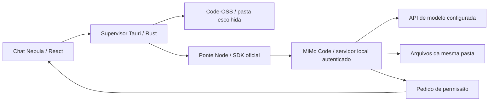

# Xiaomi MiMo integrado ao Nebula

Documento da integração React/Tauri anterior. O desktop principal agora usa o fork descrito em [MIMO-DESKTOP-FORK.md](MIMO-DESKTOP-FORK.md).

Entrega anterior de 01/10/2026. O Nebula agora executa o motor oficial [XiaomiMiMo/MiMo-Code](https://github.com/XiaomiMiMo/MiMo-Code) junto ao Code-OSS existente. A interface continua em React/Tauri; o chat cria sessões reais no MiMo, recebe texto e estados de ferramentas, apresenta pedidos de autorização e interrompe tarefas.

A interface completa do [MiMo Desktop anunciado](https://mimo-ai.xiaomimimo.com/desktop/) não foi incorporada. O guia oficial declara a superfície desktop herdada sem manutenção. Esta integração usa o motor e o SDK mantidos pela Xiaomi.

## Versões e procedência

| Componente | Versão/origem |
|---|---|
| Motor compilado macOS ARM64 | Pacote oficial npm `@mimo-ai/mimocode-darwin-arm64@0.1.15` |
| SDK | `@mimo-ai/sdk@0.1.15`, fixado no lockfile |
| Código consultado | Revisão `698f0f29058848b154eabd73d3a7955d4f18eb00`, de 30/09/2026 |
| IDE existente | Code-OSS via code-server 4.139.1, Node 24.21.0 |

O pacote npm não publica `gitHead`. A revisão consultada e a versão distribuída são registradas separadamente; não afirmamos ter compilado aquela revisão. `integrations/mimo/runtime-package.json` fixa a URL oficial e a integridade SHA-512. `mimo:prepare` verifica o arquivo e registra SHA-256 do executável em `ready.json`. O pacote inclui os avisos [LICENSE](../integrations/mimo/LICENSE) e [USE_RESTRICTIONS.md](../integrations/mimo/USE_RESTRICTIONS.md) publicados pelo upstream; a distribuição deve preservar e avaliar ambos.

## Preparar e utilizar

```sh
npm install
npm run editor:prepare
npm run mimo:prepare
npm run native:app
```

Abra `target/debug/bundle/macos/Nebula Cortex.app`. O pacote contém Node, Code-OSS, SDK empacotado na ponte e MiMo; não depende de Node instalado no computador de destino. A entrega inicial requer macOS ARM64 e ainda é um pacote de desenvolvimento sem assinatura/notarização final.

1. Use **Configurar MiMo** para informar endereço, modelo e chave. Os padrões são `https://api.xiaomimimo.com/v1` e `mimo-v2.6-flash`, conforme a [documentação oficial do modelo](https://mimo.mi.com/models/en-US/mimo-v2.6-flash). Endpoints OpenAI-compatible podem ser configurados; suporte universal a outros provedores não foi homologado.
2. Use **Abrir editor → Abrir pasta do projeto** e escolha a pasta local.
3. Volte ao chat e crie uma **Nova conversa**. Conversas novas no desktop usam MiMo; o histórico anterior mantém seu motor simulado. O seletor permite trocar o motor antes da primeira mensagem.
4. Envie a tarefa. Pedidos de acesso mostram operação, caminhos/comandos e, quando fornecido pelo motor, a diferença proposta. Escolha **Permitir uma vez** ou **Recusar**.
5. Confira o resultado na árvore do Code-OSS. **Interromper resposta** cancela a sessão ativa. Uma falha encerra a resposta; tarefas anteriores não são reenviadas automaticamente.

A chave é salva pelo Rust no Keychain, vinculada ao endereço da API. O frontend não a lê de volta, não a exporta nem a salva no histórico. Campo vazio mantém a chave daquele endereço; trocar de endereço exige uma chave correspondente. **Remover chave e redefinir** apaga a chave do endereço atual e restaura os padrões, preservando as conversas. O motor recebe a chave em seu ambiente de execução; comandos aprovados têm os privilégios do usuário.

## Arquitetura e persistência



O servidor escuta apenas em `127.0.0.1`, em porta aleatória, com senha aleatória de sessão e autenticação Basic local. Seu endereço e senha não são entregues à WebView do editor. Apenas a WebView principal usa os comandos Tauri. Rust valida requisição/conversa/permissão e aceita uma resposta por pedido; a ponte responde ao motor com `once` ou `reject`.

A pasta é canonicalizada pelo editor e identificada por SHA-256. Conversas MiMo ficam vinculadas à pasta em que começaram. A troca de projeto exige uma nova conversa ou o retorno à pasta original. O perfil fica no diretório local de dados do aplicativo, em `mimo/projects/<identificador>`. O motor usa seu próprio armazenamento persistente, incluindo SQLite, e `sessions.json` liga a conversa do Nebula à sessão remota. Uma nova tarefa pode retomar a sessão após reiniciar o processo. Não há repetição automática da tarefa interrompida.

As mensagens visíveis do Nebula continuam no `localStorage` da WebView, com exportação JSON; migrar todo o histórico da interface para SQLite permanece pendente. Recuperação transforma respostas em andamento em canceladas e não restaura autorizações pendentes.

O supervisor mata o grupo de processos da ponte ao encerrar, fechar o projeto ou detectar falha. Durante uma tarefa, eventos de atividade evitam confundir trabalho ou espera por autorização com travamento. A ponte aguarda a confirmação de aborto do motor antes de finalizar a resposta; falha nessa confirmação encerra o processo. Cancelamento do MiMo tem prazo de oito segundos antes do encerramento forçado; o motor simulado mantém dois segundos. Não há garantia de desfazer efeitos já realizados nem de encerrar processos que escapem do grupo.

## Permissões e limites desta entrega

A política da sessão pede autorização para ferramentas. Acesso externo ao worktree reconhecido pelo motor é recusado; numa subpasta de um repositório Git, esse worktree pode ser a raiz do repositório. A UI exibe os caminhos e a diferença completos para revisão. Perguntas interativas, delegação por `task`, shell interativo e `doom_loop` ficam desabilitados nesta primeira ponte. Configuração de projeto, plugins automaticamente descobertos no perfil pessoal e MCP não são importados. O motor tem perfil próprio; seus plugins/MCP ainda precisam de gestão explícita no Nebula. Extensões do Code-OSS continuam separadas.

O motor e a IDE executam com os privilégios do usuário. A política de permissões do MiMo não é uma sandbox do sistema operacional: um comando de shell aprovado pode acessar outros caminhos ou a rede. O antigo broker `packages/native-project` não intercepta ferramentas MiMo. Escritas passam pelo executor oficial; os testes demonstram aprovação, recusa e bloqueio externo, mas não homologam isolamento completo de todo comando ou symlink. Não há resolução de conflitos de edição entre um buffer não salvo no editor e uma ferramenta do agente.

Tarefas/texto exibido têm limite de 32.000 caracteres; a ponte aceita quatro tarefas e uma execução por conversa. A UI envia uma tarefa por vez. Pedidos comportam até 32 padrões, 4.000 caracteres por padrão, 24.000 no total e 16.000 na diferença. Pedidos maiores falham, sem conceder autorização com uma prévia incompleta. Cada tarefa tem limite de 15 minutos. O modelo customizado usa orçamento conservador de 131.072 de contexto e 8.192 de saída; isso não declara a capacidade máxima do modelo.

Plugins, gestão de MCP, geração de imagens, agentes paralelos, catálogo de provedores e paridade completa com Codex/MiMo Desktop permanecem entregas seguintes.

## Verificação reproduzível

```sh
npm run build:sidecar
npm run check
npm run native:test
```

26 testes JS/TS e 20 testes Rust passaram, além do build da interface e do pacote macOS. O cenário `packages/testing/src/mimo.test.ts` executa o **binário oficial** com uma API OpenAI-compatible local e chave fictícia: streaming, diferença de edição, disco intacto antes da autorização, escrita após `once`, recusa, cancelamento antes da aprovação e de shell já iniciado, bloqueio externo, erro de autenticação normalizado e retomada da mesma sessão após reiniciar a ponte. O cenário exige o runtime preparado e macOS ARM64; nas demais plataformas é marcado como não executado. Permissões de execução do ambiente devem permitir escuta em loopback.

Os testes Rust verificam resposta vinculada à tarefa/conversa, pedido consumido uma única vez, falhas do processo, cancelamento e encerramento de descendentes. Nenhuma API paga ou chave real foi usada. A chamada à API pública Xiaomi ainda depende da chave e do plano do usuário.

Para repetir a verificação visual com dados descartáveis, inicie `node --import tsx packages/testing/src/mimo-ui-fixture.ts`; ele imprime endereço local e pasta de teste. Configure esses valores e a chave fictícia no aplicativo, envie `[write] Crie approved.txt usando write`, aprove o pedido e confira o arquivo no Code-OSS. Ao terminar, remova a chave de teste pelo botão de redefinição e encerre o servidor.

### Verificação na janela nativa

Na janela do pacote, foram conferidos configuração da API de teste e gravação no Keychain, abertura da pasta descartável no Code-OSS, criação de conversa MiMo, diferença antes da escrita, aprovação uma vez, recusa e cancelamento. O arquivo aprovado apareceu na árvore e seu conteúdo foi lido no editor e no disco; os arquivos recusado/cancelado não foram criados. A configuração fictícia foi removida pela ação de redefinição. A lista de processos confirmou uso do Node, da ponte e do MiMo de `Contents/Resources`. Capturas: [permissão](mimo-permission-preview.png) e [arquivo no Code-OSS](mimo-code-oss-preview.png).
